<div align="center">

# 🎓 T3alem Codi — Online School Platform


A fully featured **online school web application** with two distinct portals — a public student-facing site and a dedicated admin dashboard — built with **Angular** and **ASP.NET Core**. Empowering the next generation of developers through modern online education.

**👨‍💻 Author:** Marnissi Ahmed Mustapha &nbsp;|&nbsp; **📅 Last Updated:** November 2026

[](https://github.com/AhmedMustaphaMarnissi)

</div>

---

## ⚡ TL;DR

**T3alem Codi** (تعلم كودي — "Learn to Code") is a full-stack e-learning platform with two separate Angular applications sharing one backend: a **public site** where students register, browse a course catalog, view course details, and check out; and an **admin dashboard** where the super admin manages students, instructors, and courses — all in a rich dark-themed UI with real-time stats and an inbox system.

👉 Two roles. Two interfaces. One platform.

---

## 💡 Key Highlights

- Two-role system: **Student** (public portal) and **Admin** (management dashboard)
- Admin dashboard with live stats: **1,284 students**, **38 active courses**, **14 instructors**, **892 completions**
- Monthly enrollment chart with New Enrollments vs. Completions trend lines
- Recent Activity feed and Top Students leaderboard on the dashboard home
- **21 courses** across domains: Computer Science, UI/UX Design, Business & Management, Data Science & AI, Software Development
- **10 instructors** managed with CIN, salary, and domain assignment
- Course catalog with domain filtering, price filtering, and free/paid badges
- Secure Checkout flow — billing info + card payment + order summary
- In-app Inbox with Compose, Inbox, Sent, Starred, Trash — full message thread view
- Dark mode toggle for both admin and student portals
- Admin Settings: My Profile, Security & Password (with 2FA toggle), Notifications, Appearance
- Student Settings: Security & Password, Notifications, Appearance

---

## 📋 Table of Contents

- [Overview](#overview)
- [Public Portal — Student Interface](#-public-portal--student-interface)
  - [Home](#-home)
  - [User Login & Register](#-user-login--register)
  - [Course Catalog](#-course-catalog)
  - [Course Details & Enrollment](#-course-details--enrollment)
  - [Secure Checkout](#-secure-checkout)
  - [Student List (User View)](#-student-list-user-view)
  - [Edit Profile](#-edit-profile)
  - [Change Password (User)](#-change-password-user)
  - [Dark Mode](#-dark-mode)
- [Admin Dashboard](#-admin-dashboard)
  - [Admin Login](#-admin-login)
  - [Dashboard Home](#-dashboard-home)
  - [Students Management](#-students-management)
  - [Add Student](#-add-student)
  - [Courses Management](#-courses-management)
  - [Course Details (Admin View)](#-course-details-admin-view)
  - [Add Course](#-add-course)
  - [Update Course](#-update-course)
  - [Instructors Management](#-instructors-management)
  - [Add Instructor](#-add-instructor)
  - [Update Instructor](#-update-instructor)
  - [Messages / Inbox](#-messages--inbox)
  - [Admin Profile & Settings](#-admin-profile--settings)
  - [Admin Security & Password](#-admin-security--password)
- [Tech Stack](#tech-stack)
- [Getting Started](#getting-started)
- [What I Learned](#-what-i-learned)

---

## Overview

**T3alem Codi** is a full-stack online learning platform built with Angular and ASP.NET Core. It provides two completely separate user experiences: a clean, red-accented **public portal** for students to discover and enroll in courses, and a polished **dark-themed admin dashboard** for the super admin (`ahmed_mar`) to manage the entire platform — students, instructors, courses, messages, and account settings.

The platform hosts 21 courses across five domains, managed by 10 instructors, with a student base of 1,284 and 892 completed enrollments tracked through a live dashboard.

---

## 🌐 Public Portal — Student Interface

### 🏠 Home

The public landing page presents T3alem Codi with the tagline **"Online School."** — a clean two-column photo grid showcasing study groups and classrooms. The left sidebar provides navigation: Home, Login, Register, and Settings.


---

### 🔑 User Login & Register

Students log in with their email and password from the Login page. New users register with a username, email, and password. Both pages feature the red T3alem Codi brand sidebar with a "Don't have an account? Register" / "Already have an account? Login" link crosslink.

| Login | Register |
|---|---|
| 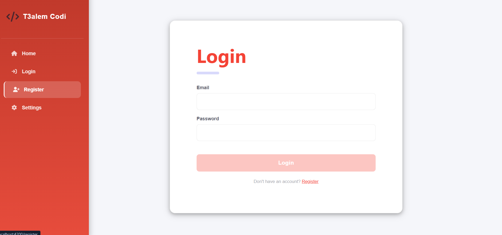 | 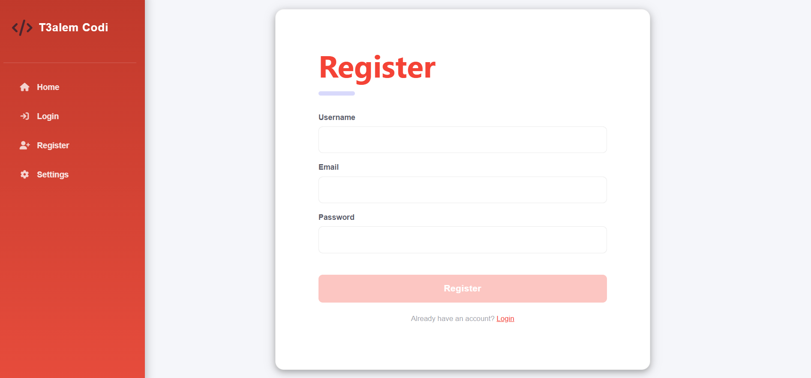 |

---

### 📚 Course Catalog

After login, students access the full course catalog — **"Explore Courses — Find the right course to level up your skills."** The grid displays courses with cover images, domain tags, price badges (Free / $90 / $100 / $120 / $130 / $150), and **Enroll Now** buttons. Filters at the top allow filtering by **All Domains** and **All Prices**.

**Sample courses visible:**

| Course | Domain | Price |
|---|---|---|
| Introduction to Algorithms | Computer Science | Free |
| Data Structures Mastery | Computer Science | $150 |
| Operating Systems Basics | Computer Science | $130 |
| Computer Architecture | Computer Science | Free |
| UI Design Fundamentals | UI/UX Design | $100 |
| Figma for Beginners | UI/UX Design | $90 |
| UX Research & Testing | UI/UX Design | Free |
| Advanced UI Prototyping | UI/UX Design | $120 |

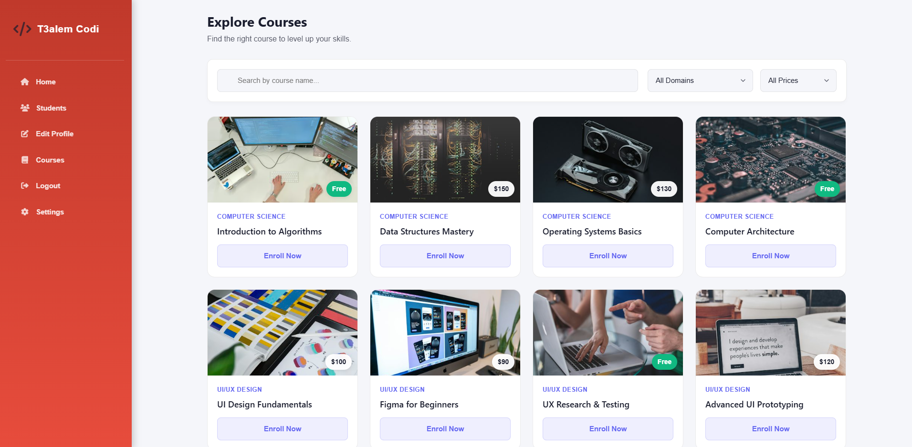

---

### 🎬 Course Details & Enrollment

Clicking a course opens the full course detail page with the cover image, domain tag, course name, price badge, instructor name, and an **"About this Course"** description section. The right sidebar shows the price, an **Enroll Now** button, and a 30-Day Money-Back Guarantee.

**Sample:** Python for Data Science — DATA SCIENCE & AI — Free — Instructor: Walid Ferjani
> "Learn how to use Python as a powerful tool for data analysis, visualization, and exploration. This course covers Python fundamentals and then dives into libraries like NumPy, Pandas, and Matplotlib..."

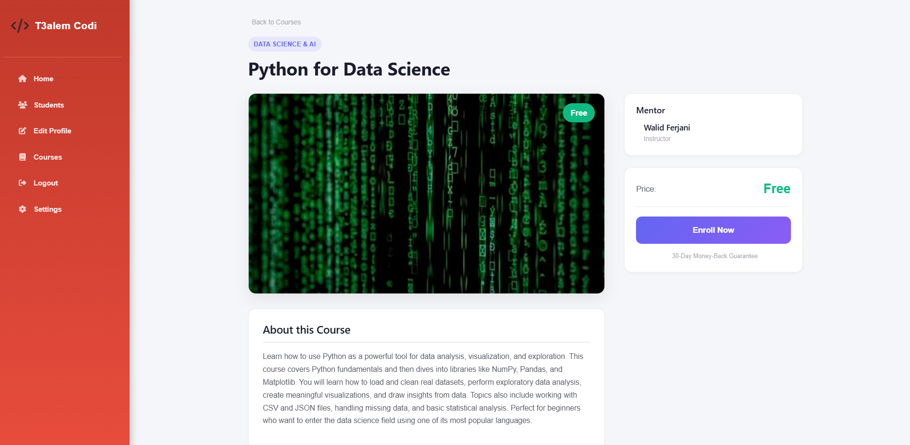

---

### 💳 Secure Checkout

Clicking **Enroll Now** on a paid course opens the **Secure Checkout** page with two panels:

- **Billing & Payment** — Email Address, Phone Number, Address, Name on Card, Card Number, Expiry Date, CVV
- **Order Summary** — course thumbnail, domain tag, course name, instructor, Original Price, Taxes & Fees, and Total

**Sample checkout:** Python for Data Science — DATA SCIENCE & AI — Total: **Free** — Pay Free button

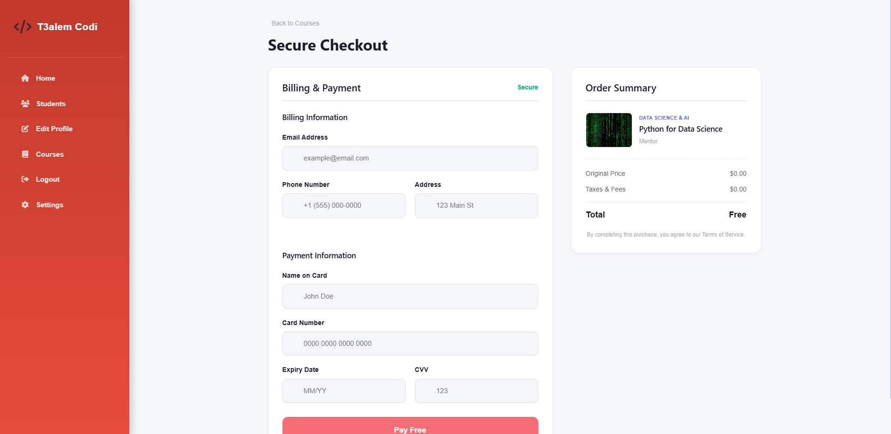

---

### 👥 Student List (User View)

Logged-in students can view the full student directory — 9 total students enrolled — showing ID, First Name, Last Name, Email, Age, and Phone in a clean table with a search bar. This is a read-only view compared to the admin version.

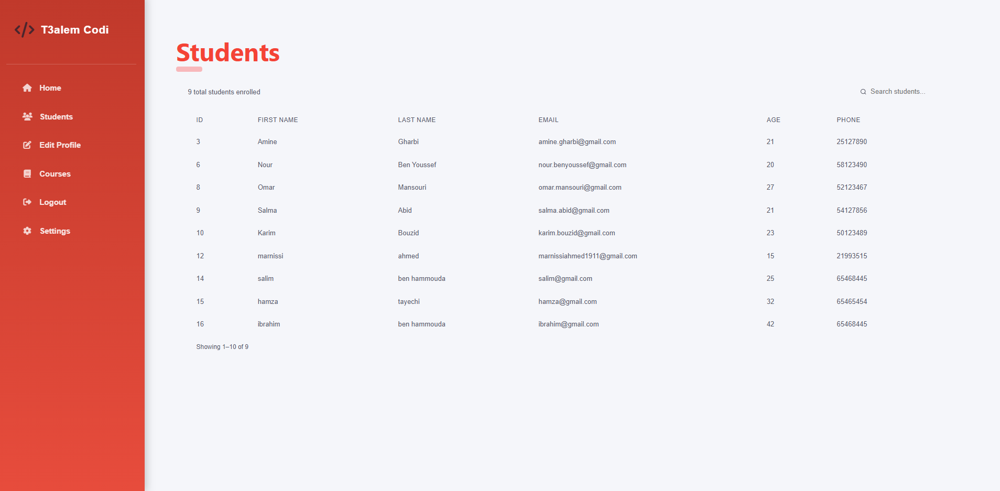

---

### ✏️ Edit Profile

Students can edit their account from the **Edit Profile** modal — Username, Email, and new Password fields with Save Changes / Cancel buttons.

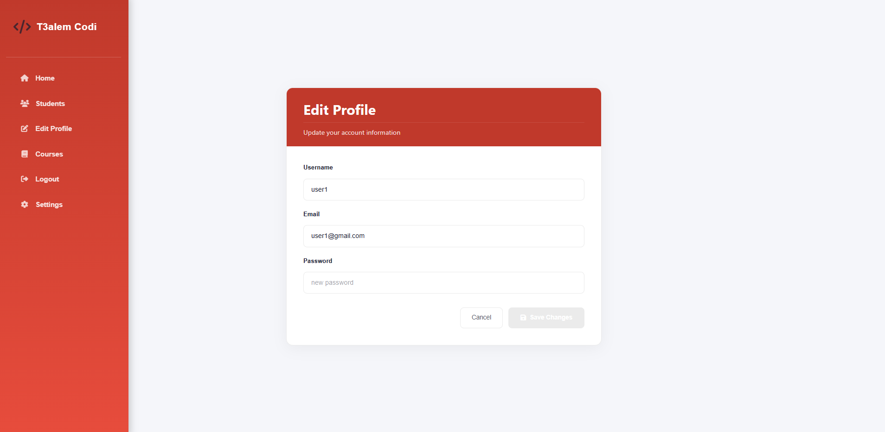

---

### 🔒 Change Password (User)

The student Settings panel includes **Security & Password** — Current Password, New Password, and Confirm Password fields with an **Update Password** button.

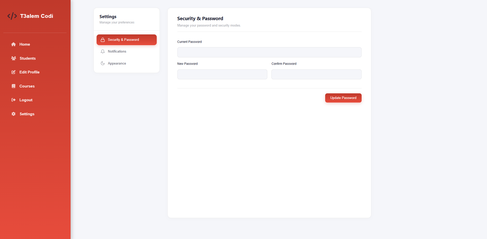

---

### 🌙 Dark Mode

The student portal includes an **Appearance** settings panel with a Dark Mode toggle switch — switching between light and dark themes across the entire student interface.

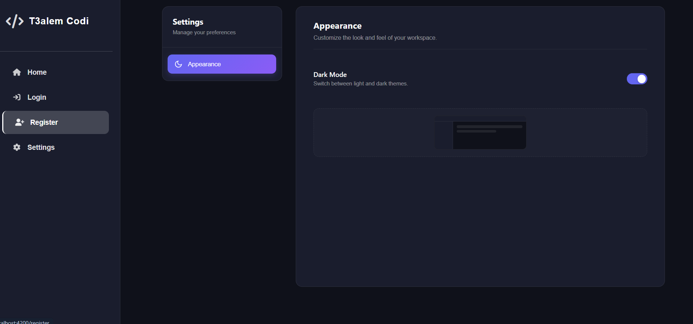

---

## 🛠️ Admin Dashboard

### 🔐 Admin Login

The admin login page is a full-screen split layout: a left hero with the T3alem Codi logo, the platform tagline ("Empowering the next generation of developers through modern online education"), and live platform stats (**1.2k+ Students · 48 Courses · 12 Instructors**). The right side shows the sign-in form with email (`admin@t3alemcodi.com`) and password fields.

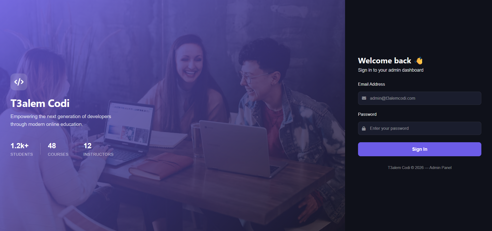

---

### 📊 Dashboard Home

The admin dashboard home displays four KPI cards at the top:

| Metric | Value | Trend |
|---|---|---|
| Total Students | **1,284** | +12% this month |
| Active Courses | **38** | +3 new courses |
| Instructors | **14** | +1 this month |
| Completions | **892** | -5% vs last month |

A full **Course Enrollments** line chart shows monthly New Enrollments vs. Completions from January through December. A **Recent Activity** feed on the right logs latest events with timestamps and action badges (Enroll, Quiz, Project, Review):

- Ahmed M. enrolled in Angular Fundame... — 2 min ago
- Sara R. completed C++ Basics quiz — 15 min ago
- Khaled T. submitted STM32 project — 1 hr ago
- Lina B. started JavaScript course — 3 hrs ago
- Mohamed N. left a review on Python c... — 5 hrs ago

The **Top Courses by Enrollment** widget lists the platform's most popular courses:

1. Angular Fundamentals — by Ahmed K. — 82%
2. C++ for Beginners — by Sara M. — 74%
3. STM32 Embedded — by Bilal R. — 61%

The **Top Students Leaderboard** shows:

| # | Student | Course | Score | Status |
|---|---|---|---|---|
| 1 | Sara R. | Angular | 98% | Active |
| 2 | Ahmed M. | C++ | 95% | Active |
| 3 | Lina B. | Python | 91% | Active |

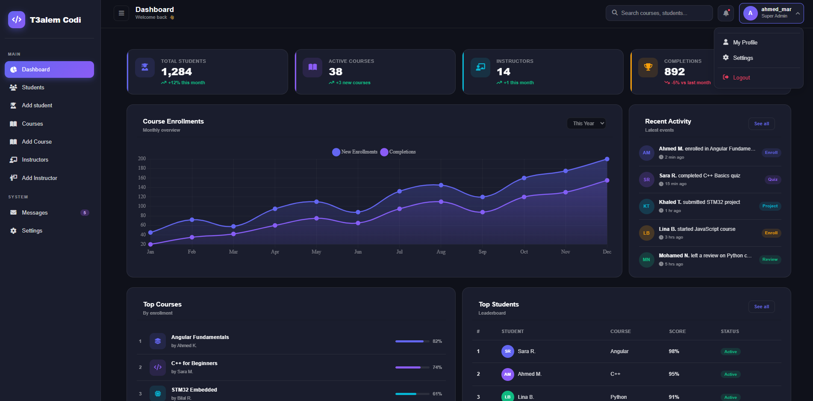

---

### 👥 Students Management

The Students panel lists all enrolled students in a searchable table: **9 total students enrolled** — columns: ID, First Name, Last Name, Email, Age, Phone, and Actions (Edit / Delete).

**Students in the system:**

| ID | Name | Email | Age |
|---|---|---|---|
| 3 | Amine Gharbi | amine.gharbi@gmail.com | 21 |
| 6 | Nour Ben Youssef | nour.benyoussef@gmail.com | 20 |
| 8 | Omar Mansouri | omar.mansouri@gmail.com | 27 |
| 9 | Salma Abid | salma.abid@gmail.com | 21 |
| 10 | Karim Bouzid | karim.bouzid@gmail.com | 23 |
| 12 | marnissi ahmed | marnissiahmed1911@gmail.com | 15 |
| 14 | salim ben hammouda | salim@gmail.com | 25 |
| 15 | hamza tayechi | hamza@gmail.com | 32 |
| 16 | ibrahim ben hammouda | ibrahim@gmail.com | 42 |

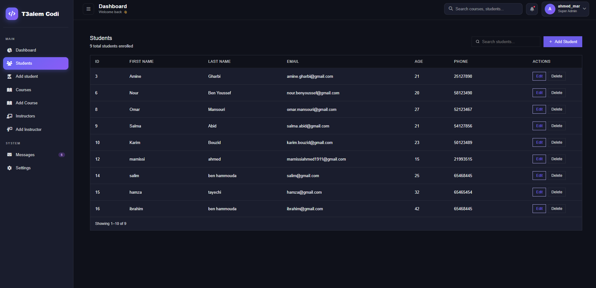

---

### ➕ Add Student

The admin can register a new student via the **Add Student** form: First Name, Last Name, Email, Age, and Phone — with Reset and Add Student buttons.

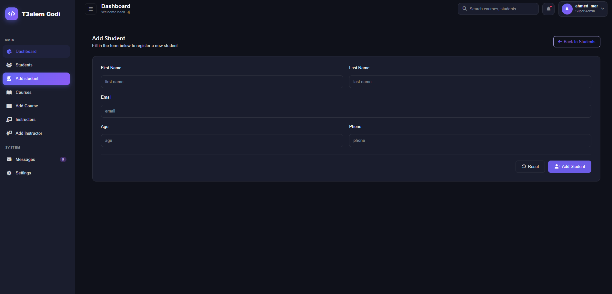

---

### 📚 Courses Management

The Courses admin panel lists **21 total courses available** in a paginated table (10 per page) — columns: ID, Name, Price, Domain, and Actions (Edit / Details). The search bar and "+ Add Course" button sit in the top right.

**Courses visible (page 1 of 3):**

| ID | Course | Price | Domain |
|---|---|---|---|
| 2 | Introduction to Algorithms | Free | Computer Science |
| 3 | Data Structures Mastery | $150 | Computer Science |
| 4 | Operating Systems Basics | $130 | Computer Science |
| 5 | Computer Architecture | Free | Computer Science |
| 6 | UI Design Fundamentals | $100 | UI/UX Design |
| 7 | Figma for Beginners | $90 | UI/UX Design |
| 8 | UX Research & Testing | Free | UI/UX Design |
| 9 | Advanced UI Prototyping | $120 | UI/UX Design |
| 10 | Business Strategy Basics | $160 | Business & Management |
| 11 | Project Management Essentials | $150 | Business & Management |

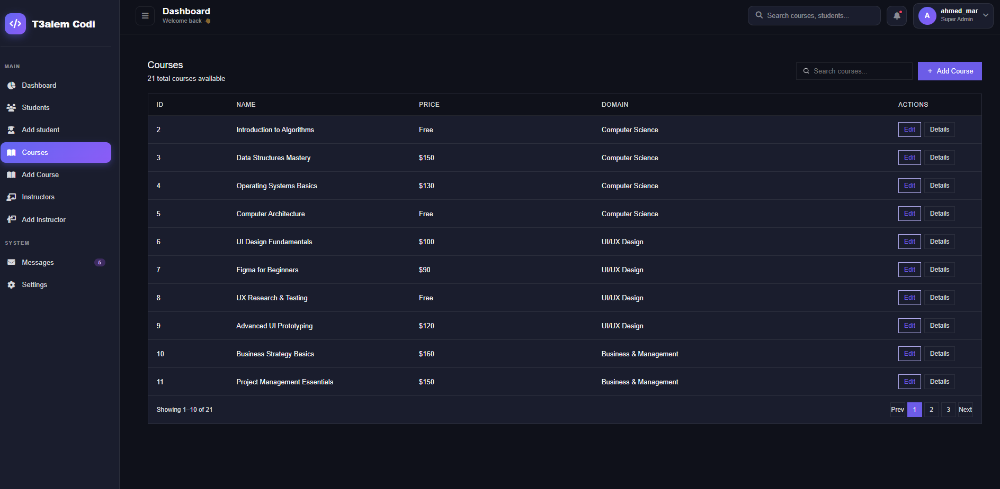

---

### 🔍 Course Details (Admin View)

Clicking **Details** on any course opens the full Course Details page — course thumbnail, domain tag, active/inactive status toggle, course name, price, instructor name, creation date, and a full description section.

**Sample:** Introduction to Algorithms — COMPUTER SCIENCE — INACTIVE — Free — Instructor: Ahmed Ben Ali
> "This course covers the fundamental algorithms every developer must know. You will explore sorting algorithms such as bubble sort, merge sort, and quicksort, along with searching techniques like binary search. The course also introduces problem-solving strategies, time and space complexity analysis using Big-O notation, and recursive thinking..."

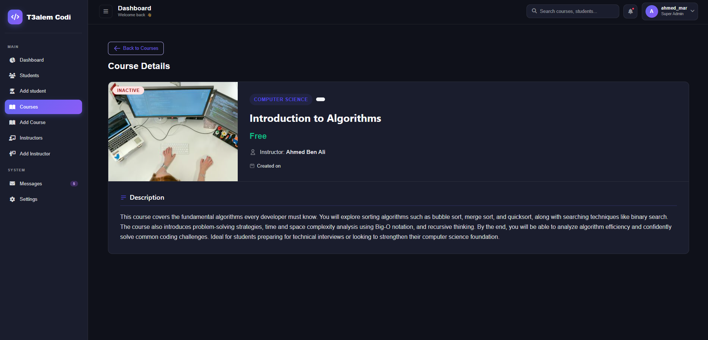

---

### ➕ Add Course

The **Add Course** form collects: Course Name, Description (up to 1000 characters), Price ($), Image URL, Domain (dropdown), and Instructor (filtered by selected domain — "Choose a domain to see available instructors") — with Reset and + Add Course buttons.

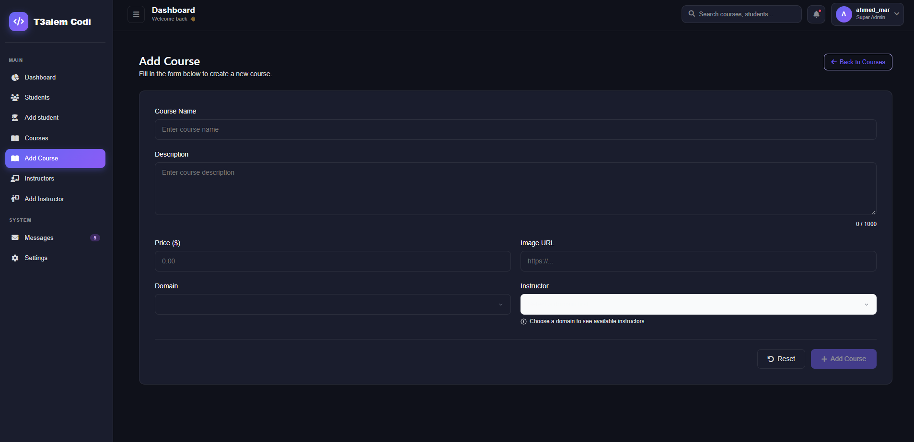

---

### ✏️ Update Course

Clicking **Edit** on a course opens an **Update Course** modal dialog over the courses table — prefilled with the current Name, Description, Price, and a Picture file picker — with Cancel and Save Changes buttons.

**Sample:** Operating Systems Basics — $130 — "Get a solid understanding of how operating systems ma..."

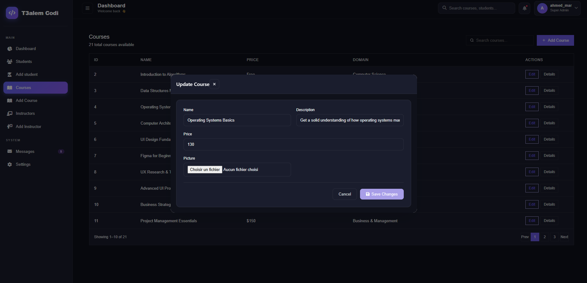

---

### 👨‍🏫 Instructors Management

The Instructors panel lists **10 instructors** registered in the system — columns: ID, Instructor (name), CIN, Salary, Domain, and Actions (Edit / Delete). Searchable by name or CIN.

**Instructors in the system:**

| ID | Name | CIN | Salary | Domain |
|---|---|---|---|---|
| 11 | Ahmed Ben Ali | 12345678 | 5000 | Software Development |
| 12 | Sami Trabelsi | 87654321 | 2700 | Computer Science |
| 13 | Yasmine Kouki | 11223344 | 2200 | UI/UX Design |
| 15 | Hatem Mansouri | 22334455 | 3000 | Business & Management |
| 16 | Amira Chaabane | 66778899 | 3100 | Business & Management |
| 17 | Mohamed Gharbi | 33445566 | 2800 | Software Development |
| 18 | Rania Mejri | 77889900 | 2900 | Software Development |
| 20 | Salma Zitouni | 88990011 | 3300 | Data Science & AI |
| 24 | allala mar | 55465415 | 2800 | UI/UX Design |
| 26 | hamza lakhther | 55465415 | 900 | Data Science & AI |

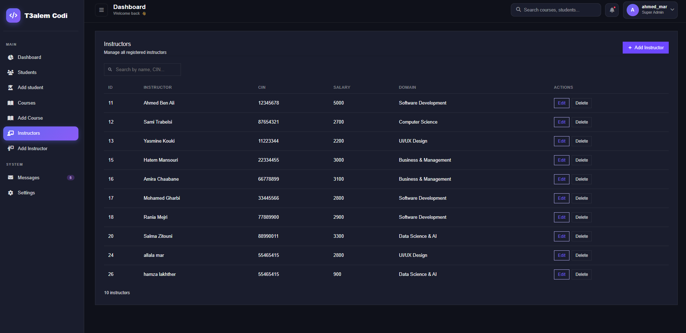

---

### ➕ Add Instructor

The **Add Instructor** form registers a new instructor with: First Name, Last Name, CIN, Salary, and Domain Name (dropdown) — with Reset and Add Instructor buttons.

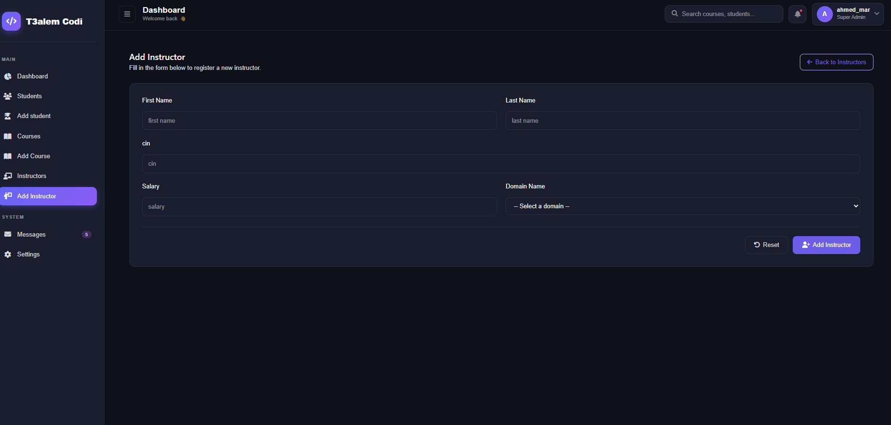

---

### ✏️ Update Instructor

Clicking **Edit** on an instructor opens the **Update Instructor** modal — prefilled with First Name, Last Name, CIN, Salary, and Domain Name dropdown — with Cancel and Save Changes buttons.

**Sample:** Ahmed / Ben Ali — CIN: 12345678 — Salary: 5000 — Software Development

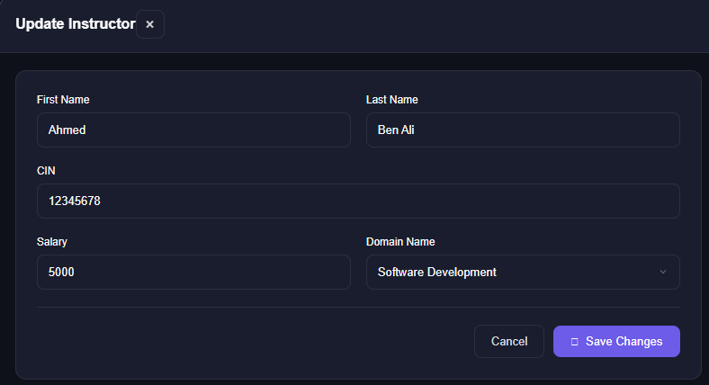

---

### 📬 Messages / Inbox

The admin has a full **Inbox** with Compose, Inbox (badge: 1 unread), Sent, Starred, and Trash panels. Selecting a message opens the full thread on the right with Reply and Delete actions.

**Messages in the inbox:**

| Sender | Subject | Status |
|---|---|---|
| Ali Ben Salah | Course Enrollment Request | Today, 09:15 |
| Fatima Zahra | Payment Issue on Platform | Today, 08:40 — Unread |
| Mohamed Haddad | Certificate Request | Yesterday |
| Nour Khelil | Instructor Application | Mon, 10:00 |

**Active message:** Ali Ben Salah — "Hello, I would like to enroll in the Angular course available on the platform. Could you please provide me with the necessary steps to complete the enrollment? Thank you, Ali"

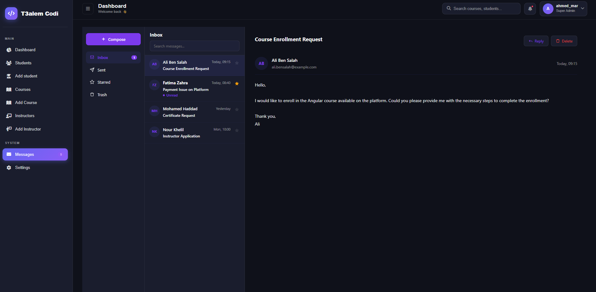

---

### 👤 Admin Profile & Settings

The admin Settings page has four tabs: **My Profile**, **Security & Password**, **Notifications**, and **Appearance**. The My Profile section shows the avatar (initials "ah"), with Change Avatar / Remove options, and editable fields for Username (`ahmed_mar`), Email Address (`marnissiahmed1911@gmail.com`), Role (`Admin`), and Bio ("System Administrator for T3alem Codi.").

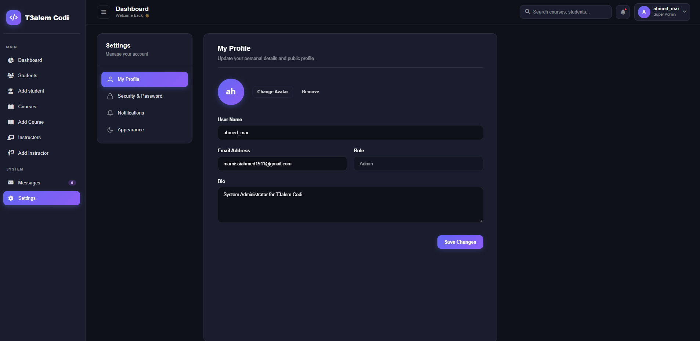

---

### 🔒 Admin Security & Password

The Security & Password settings panel allows the admin to change their password (Current Password → New Password → Confirm New Password) and toggle **Two-Factor Authentication** on/off with an **Update Security** button.

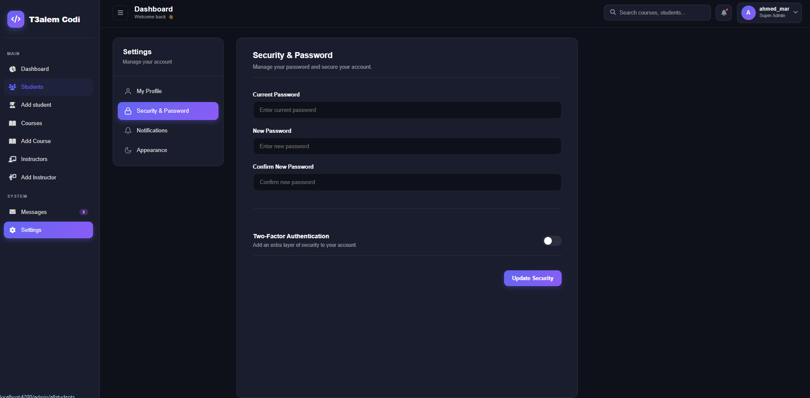

---

## Tech Stack

| Layer | Technology |
|---|---|
| Frontend Framework | Angular (TypeScript) |
| Styling | CSS3 — custom theme system (red public / dark purple admin) |
| Backend | ASP.NET Core Web API |
| Database | SQL Server |
| Authentication | Session / JWT-based login (Admin + Student roles) |
| Charts | Line chart — Monthly enrollment overview |
| Icons | Icon library (dashboard sidebar icons) |
| Dark Mode | CSS theme toggle — Appearance settings |

---

## Getting Started

### Prerequisites

- Node.js and Angular CLI
- .NET SDK (ASP.NET Core)
- SQL Server

### Setup

1. **Clone the repository:**
   ```bash
   git clone https://github.com/ahmedmustaphamarnissi/T3alem-Codi.git
   ```

2. **Navigate to the project folder:**
   ```bash
   cd T3alem-Codi
   ```

3. **Install frontend dependencies:**
   ```bash
   npm install
   ```

4. **Configure the backend connection string** in `appsettings.json` (SQL Server database).

5. **Run the backend API:**
   ```bash
   dotnet run
   ```

6. **Run the Angular frontend:**
   ```bash
   ng serve
   ```

7. **Open your browser** at `http://localhost:4200`

8. **Admin portal:** Navigate to `/admin/login` — sign in with admin credentials to access the full dashboard.

---

## 🧠 What I Learned

- Building a **multi-role Angular application** with two completely separate portals (public + admin) from a single codebase
- Designing a **dark-themed admin dashboard** with live stats cards, a monthly line chart, an activity feed, and a leaderboard
- Implementing a **course catalog** with domain and price filtering, free/paid badge logic, and an enrollment flow
- Building a **Secure Checkout** page with billing info and payment card fields alongside a live order summary
- Creating a full **inbox/messaging system** with Compose, Inbox, Sent, Starred, and Trash navigation
- Managing a full **CRUD flow** for Students, Courses, and Instructors from the admin dashboard
- Implementing **Settings panels** (Profile, Security & Password with 2FA, Notifications, Appearance) for both admin and student roles
- Connecting an Angular frontend to an **ASP.NET Core + SQL Server** backend with role-based data access

---

<div align="center">

Built with ❤️ in Bizerte, Tunisia 🇹🇳

[](https://github.com/AhmedMustaphaMarnissi)

</div>